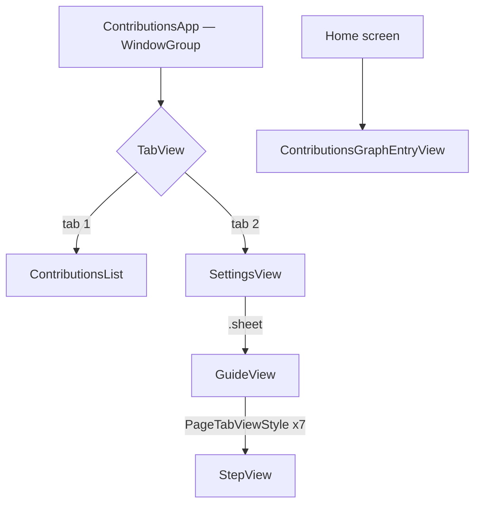

# Navigation Flow

Every navigation destination, what presents it, and how the user gets there.

**Read it when** adding a screen, wiring a deep link, or checking whether a flow is reachable.
- **Companion:** [FEATURES.md](FEATURES.md) — screens and their view models.
- **Last synced:** 2026-09-08

---

## ⚠ There is no `Route` enum in this repo

`grep` for `Route*.swift` returns **zero files**, and there is no `navigationDestination` anywhere.
Navigation is entirely **structural** — declared by view nesting in `ContributionsApp`, not by route
values. There is no router, no path stack, and nothing to deep-link into.

That makes the generated route table below permanently empty, which is correct rather than a
failure. The hand-written sections that follow describe the navigation that actually exists.

<!-- GA:ROWS — generated by Scripts/sync-notes.sh; edits between these markers are overwritten -->
| Route case | Payload | Defined in — *what's there* | Rendered by — *what's there* | Entry points | Deep link |
|---|---|---|---|---|---|
| — | — | — | — | — | — |
<!-- GA:ROWS end -->

## Destinations — hand-maintained

| Destination | Presented by | Presentation | Dir |
|---|---|---|---|
| `ContributionsList` | `ContributionsApp` — tab 1, inside `NavigationStack` | tab root, `square.grid.3x3.fill` | Contributions/List/ |
| `SettingsView` | `ContributionsApp` — tab 2, inside `NavigationStack` | tab root, `gearshape.fill` | Contributions/Settings/ |
| `GuideView` | `SettingsView` — `.sheet(isPresented: $isGuidePresented)`, wrapped in `NavigationView` | modal sheet, dismissed by `widget-guide-done` | Contributions/Guide/ |
| `StepView` | `GuideView` — `TabView` with `PageTabViewStyle` | 7 paged steps, `widget-guide-step-N-*` | Contributions/Guide/ |
| `ContributionsGraphEntryView` | WidgetKit — `ContributionsGraphWidget` | home-screen widget, outside the app's navigation | ContributionsWidget/ |

**Composition root:** `ContributionsApp` constructs `DefaultContributionsStorage()` and injects it
into `ContributionsList`'s view model — the one place that wires dependencies (CLAUDE.md §2.6).

## Flow

Real edges only. Each node's `click` target is the file that renders it.



## Container structure

| Size class | Container | Root selection |
|---|---|---|
| all | `TabView` with two `NavigationStack`s | fixed — no size-class branching anywhere |

There is no adaptive layout: the same `TabView` renders on iPhone and iPad. `UISupportedInterfaceOrientations`
allows portrait only on iPhone, all four on iPad.

## Deep links

| URL pattern | Parses to | Parser — *what's there* | Requires auth | Fallback if unauthorized |
|---|---|---|---|---|
| — none | — | no parser exists | — | — |

**No URL scheme and no universal links.** `CFBundleURLTypes` is absent from `Info.plist`, and there
is no AASA file — recorded ⛔ in [GAPS.md](../../docs/GAPS.md). Nothing can link into this app.

## Scenes & windows

| Scene | Platform | Declared in — *what's there* | Owns its own Router | Restoration |
|---|---|---|---|---|
| `WindowGroup` | iOS / iPadOS | Contributions/ — `ContributionsApp`, the only app scene | n/a — no router exists | none |
| `WidgetBundle` | iOS / iPadOS | ContributionsWidget/ — `ContributionsWidgetBundle` | n/a | WidgetKit timeline |

`UIApplicationSupportsMultipleScenes` is `true` in `Info.plist`, but no per-scene state is kept, so
two windows would share nothing.

## Using this as an index

```bash
# a destination → the file that renders it, plus a note on what that file is
grep -n "GuideView" .claude/notes/NAVIGATION.md

# every file the graph touches, deduped — for a refactor's blast radius
grep -o '[A-Za-z/]*\.swift' .claude/notes/NAVIGATION.md | sort -u

# the whole node → file map, tooltips included
grep -n "click " .claude/notes/NAVIGATION.md
```

If a path in here does not exist, the note is stale — that is a `Gaps` row, not something to ignore.

## Gaps

| Finding | Where | Noted |
|---|---|---|
| No route layer at all | repo-wide | Every destination is reachable only by direct construction. That is *consistent* here — with 4 destinations and no deep links there is nothing for a router to decouple — but it means a deep link, a state restoration, or a fifth screen has no seam to attach to |
| `NavigationView` is deprecated | Contributions/Settings/ — the guide sheet | The two tab roots use `NavigationStack`; the sheet still uses `NavigationView`. Inconsistent, and deprecated since iOS 16 |
| `UIApplicationSupportsMultipleScenes` is true with no scene state | Contributions/Info.plist | Declared but unused; two windows would share no state. Harmless today on iPhone, visible on iPad |
| `UIRequiredDeviceCapabilities` requires `armv7` | Contributions/Info.plist | A 32-bit capability on an iOS 16.6 app. Vestigial — every supported device is arm64. **A candidate**, not a verdict: harmless, but misleading |

**Not checked:** whether the guide's 7 steps are all reachable by swipe; iPad split-view behaviour;
and whether the widget's tap target should deep-link into the app, which is a product decision.
